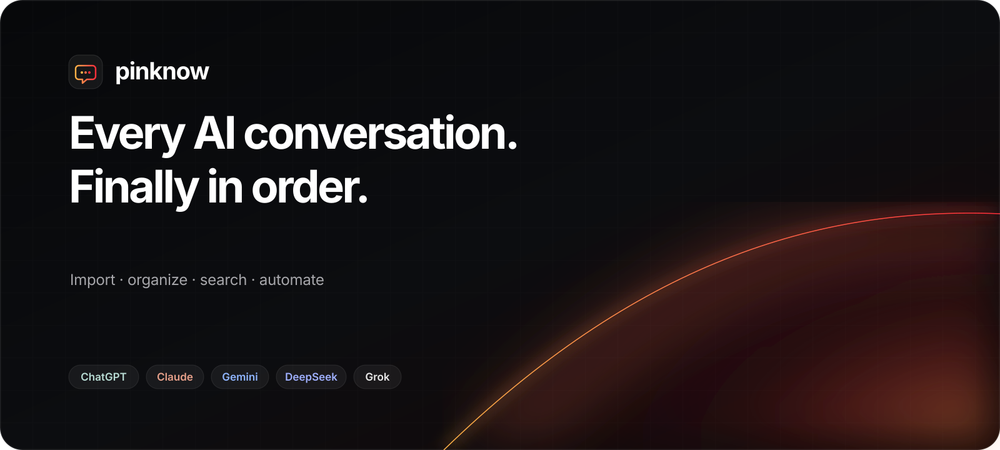
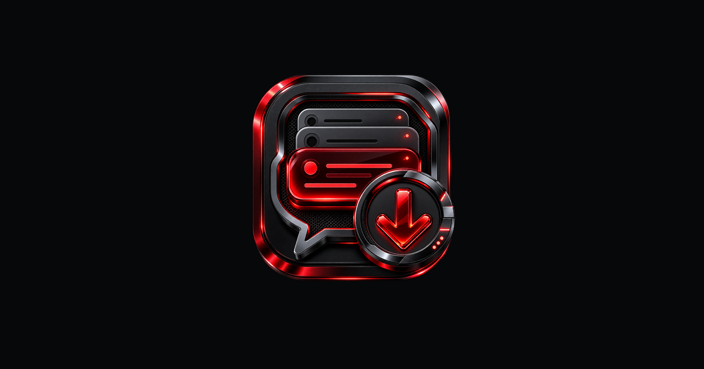
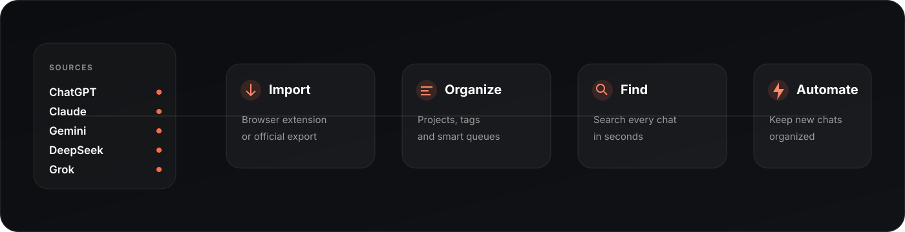
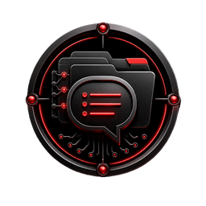

<p align="center">
  
</p>

<p align="center">
  <strong>A calm, searchable home for the conversations that power your work.</strong>
  <br />
  Import from five AI assistants, let pinknow organize the library, and find any past answer in seconds.
</p>

<p align="center">
  <a href="https://pinknow.netlify.app/"><strong>Open pinknow ↗</strong></a>
  &nbsp;&nbsp;·&nbsp;&nbsp;
  <a href="#how-it-works">How it works</a>
  &nbsp;&nbsp;·&nbsp;&nbsp;
  <a href="#privacy-by-design">Privacy</a>
  &nbsp;&nbsp;·&nbsp;&nbsp;
  <a href="#frequently-asked-questions">FAQ</a>
</p>

<p align="center">
  
  
  
  
</p>

---

## Your best thinking should not disappear into a sidebar

AI conversations hold research, decisions, drafts, code, plans, and the context behind them. But that knowledge is split across providers and buried in histories designed for recency—not retrieval.

**pinknow turns scattered chat history into a living knowledge library.** It brings conversations together, files them into projects and tags, highlights what still needs attention, and keeps everything searchable from one place.

<p align="center">
  <a href="https://pinknow.netlify.app/">
    
  </a>
</p>

## One library. Five assistants.

| Bring everything in | Let the library organize itself | Retrieve the right context |
|:---|:---|:---|
| Import from **ChatGPT, Claude, Gemini, DeepSeek, and Grok** through the browser extension, or use an official export file. | AI-assisted projects and tags turn a flat archive into a structure you can understand and refine. | Search across every project, use smart queues, or open the command palette when you already know what you need. |

### Built for the full knowledge lifecycle

- **Unified conversation library** — one place for chats from multiple AI providers.
- **AI-assisted organization** — projects, tags, and suggestions that you review instead of filing everything manually.
- **Fast cross-library search** — retrieve old answers without remembering which assistant produced them.
- **Smart queues** — surface unsorted, pinned, long, media-rich, archived, or high-debt conversations.
- **Triage and debt scoring** — identify unresolved or neglected threads before useful work gets lost.
- **Visual workflows** — define what should happen to new conversations without writing code.
- **Organizer Studio** — clean up projects and tags without losing the underlying conversation.
- **Decisions & issues** — preserve outcomes and open questions, not just raw transcripts.
- **Statistics and library health** — understand how the knowledge base is growing and where it needs attention.
- **Desktop depth, mobile clarity** — a power-user workspace on desktop and focused navigation on phones.

## How it works

<p align="center">
  
</p>

1. **Import** a provider export, or deliberately trigger an import from the browser extension.
2. **Review** the projects, tags, and suggested organization created for your conversations.
3. **Find and reuse** past knowledge through search, smart queues, and the command palette.
4. **Automate** recurring organization so new chats land in the right place from then on.

## More than storage

Most archives stop once the data is saved. pinknow is designed around what happens next.

| Capability | What it unlocks |
|:---|:---|
| **Organizer Studio** | Turn an unstructured import into a clean, navigable library. |
| **Smart queues** | See exactly what is unsorted, important, aging, or unfinished. |
| **Debt score** | Spot conversations that contain unresolved work or neglected follow-up. |
| **AI Workflows** | Apply repeatable organization to new conversations automatically. |
| **Knowledge map** | Explore relationships beyond folders and chronological lists. |
| **Public HTTP API** | Use your own scripts and tools against the same account-scoped data. |

## Privacy by design

Your chat history is personal working memory. pinknow treats it that way.

- **Nothing imports until you ask.** The browser extension acts only after an explicit import action.
- **Account-scoped data.** Application reads and writes are tied to the authenticated owner.
- **Local file parsing.** The extension parses supported export files locally before you choose what to do next.
- **Provider-limited access.** Extension access is restricted to the supported AI provider domains.
- **No invented sharing model.** Your library is yours; pinknow does not treat imported conversations as public content.

> The extension uses different import strategies according to provider capabilities. ChatGPT import can use the active site session; other supported providers are read from the conversation already rendered in the browser. Site interfaces can change, so DOM-based imports include a user-controlled recalibration path.

## Product surfaces

```text
pinknow
├── AI Import Center       bring conversations into the library
├── Organizer Studio       review and refine automatic organization
├── Projects & Tags        build a durable information structure
├── Conversations          search, read, pin, archive, and manage
├── Triage                 resolve the threads that still need attention
├── Decisions & Issues     preserve outcomes and open questions
├── AI Workflows           automate repeatable organization
├── Map                    explore relationships visually
├── Statistics             understand activity and library health
├── Browser Extension      import directly from supported providers
└── HTTP API               connect personal scripts and workflows
```

## Product principles

1. **You review; pinknow files.** Automation should remove sorting work while keeping you in control.
2. **Finding beats storing.** A conversation is valuable when it can be retrieved at the moment it matters.
3. **Provider-neutral by default.** Your knowledge should not be trapped in one assistant's interface.
4. **Explicit and private.** Imports and actions happen deliberately, inside the signed-in account.
5. **Plain language over system language.** The product is for anyone with too many AI chats—not only developers.

## Frequently asked questions

<details>
<summary><strong>Which AI assistants are supported?</strong></summary>
<br />
pinknow currently supports ChatGPT, Claude, Gemini, DeepSeek, and Grok. Import behavior varies by provider because their websites and available export paths differ.
</details>

<details>
<summary><strong>Does pinknow import conversations automatically in the background?</strong></summary>
<br />
No. Import begins only after an explicit user action.
</details>

<details>
<summary><strong>Can I use my official ChatGPT export?</strong></summary>
<br />
Yes. The import flow supports the official export archive or its <code>conversations.json</code> file.
</details>

<details>
<summary><strong>Is there an API?</strong></summary>
<br />
Yes. pinknow exposes an authenticated HTTP API for account-scoped queries, search, statistics, and automation workflows.
</details>

<details>
<summary><strong>Is the source code available in this repository?</strong></summary>
<br />
No. This is the official public product showcase for pinknow. The application and extension source code are maintained privately.
</details>

## Project status

pinknow is actively evolving. Product availability and supported provider behavior may change as provider interfaces change. Pricing is not published here because paid plans are still being finalized.

For the current product experience, visit **[pinknow.netlify.app](https://pinknow.netlify.app/)**.

---

<p align="center">
  
</p>

<p align="center">
  <strong>Stop re-asking. Start finding.</strong><br />
  <sub>© 2026 pinknow. All rights reserved.</sub>
</p>

> **Repository notice:** this repository is a product presentation and documentation surface. It does not grant a license to the private pinknow application, extension, brand assets, or source code.

